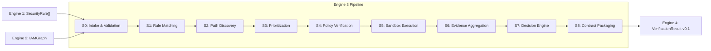

# Project IAM — Multi-Engine AWS IAM Security Analysis & Verification Platform

Project IAM is an automated IAM analysis and exploitability verification framework composed of four collaborating engines:

1. **Engine 1**: Rulebook Authoring & Security Rule Curation (`SecurityRule v0.1`).
2. **Engine 2**: IAM Graph Extraction, Snapshotting, and Semantic Edge Construction (`IAMGraph v0.1`).
3. **Engine 3**: Multi-Hop Attack Path Discovery, Policy Simulation, Sandboxed Verification, and Status Evaluation (`VerificationResult v0.1`).
4. **Engine 4**: Visualization, Triage, Remediation, and Handoff Reporting.

---

## 🎯 Engine 3 (Attack + Verification) Summary

Engine 3 implements an end-to-end, deterministic pipeline across 9 stages (**S0 through S8**):



---

## 📋 Completed Capabilities & Milestones

### 1. Stage 0: Intake & Validation ([`engine3/src/engine3/s0_intake.py`](file:///d:/Project%20IAM/engine3/src/engine3/s0_intake.py))
- Full contract schema validation for `IAMGraph v0.1` and `SecurityRule v0.1`.
- Graph consistency validation: checks duplicate IDs, dangling edge endpoints, unknown node/edge types, enum values, and required rule fields.
- SHA256 cryptographic hashing of raw input artifacts.
- Graceful degraded-mode flagging when input snapshots reflect partial collection status.

### 2. Stage 1: Rule Matching ([`engine3/src/engine3/s1_rule_matching.py`](file:///d:/Project%20IAM/engine3/src/engine3/s1_rule_matching.py))
- Matching against contract model fields: `action`, `principal_type`, `resource_type`, and condition blocks.
- Deterministic rule status filtering (`active` vs `draft`).
- Preserves rule metadata (`source_path_id`) for downstream module resolution.

### 3. Stage 2: Path Discovery ([`engine3/src/engine3/s2_path_discovery.py`](file:///d:/Project%20IAM/engine3/src/engine3/s2_path_discovery.py))
- Multi-hop graph search with configurable depth limit (`max_depth=6`).
- Cycle detection preventing infinite loops while avoiding path explosion.
- Deterministic `path_id` hash calculation for every candidate path.

### 4. Stage 3: Prioritization & Queue ([`engine3/src/engine3/s3_prioritization.py`](file:///d:/Project%20IAM/engine3/src/engine3/s3_prioritization.py))
- Multi-factor scoring formula combining rule severity (`CRITICAL`, `HIGH`, `MEDIUM`, `LOW`), hop count, and assumption penalties.
- Deterministic tie-breaking across path candidates.

### 5. Stage 4: Policy Verification ([`engine3/src/engine3/s4_policy_verification.py`](file:///d:/Project%20IAM/engine3/src/engine3/s4_policy_verification.py))
- **Local Policy Simulator**: Fast offline evaluator checking Deny statements, permissions boundaries, and condition blocks.
- **Live AWS Policy Simulator**: Boto3 client evaluating `SimulatePrincipalPolicy` guarded by the `APPROVE-LIVE-SIM` safety gate and exponential backoff handling.

### 6. Stage 5: Sandbox Execution ([`engine3/src/engine3/s5_sandbox.py`](file:///d:/Project%20IAM/engine3/src/engine3/s5_sandbox.py))
- **Dynamic Module Resolver ([`module_resolver.py`](file:///d:/Project%20IAM/engine3/src/engine3/sandbox/module_resolver.py))**: Indexes all 179 rules in `active_rulebook.json` to 92 on-disk `pathfinding.cloud` YAML module definitions (175 privesc modules + 4 goal exfiltration rules).
- **Client Hierarchy ([`pathrunner_client.py`](file:///d:/Project%20IAM/engine3/src/engine3/sandbox/pathrunner_client.py))**:
  - `PathrunnerClient` (Abstract Base Class).
  - `SubprocessPathrunnerClient`: Real CLI execution with clean environment scrubbing, timeout enforcement, and 4 mandatory safety gates.
  - `MockPathrunnerClient`: Deterministic mock client for unit testing with mandatory `[MOCK]` log prefixes and `verification_source="MOCK"` tagging.
- **Branch Orchestrator ([`orchestrator.py`](file:///d:/Project%20IAM/engine3/src/engine3/sandbox/orchestrator.py))**: Walks candidate attack hops in order. Zero string-sniffing and zero fabricated credentials—credentials transition strictly from `ModuleResult.captured_credentials`. Intermediate hops halting without credentials trigger `SANDBOX_FAILED`.
- **Stopwatch Timers**: Records real millisecond execution times for `deploy`, `execute`, and `destroy` phases in `runtime_metrics.sandbox_breakdown_ms`.

### 7. Stage 6 & Stage 7: Evidence & Decision Separation ([`s6_evidence.py`](file:///d:/Project%20IAM/engine3/src/engine3/s6_evidence.py) & [`s7_decision.py`](file:///d:/Project%20IAM/engine3/src/engine3/s7_decision.py))
- Stage 6 performs pure aggregation of graph, policy simulation, and sandbox execution evidence.
- Stage 7 evaluates evidence against the formal 5-tier Verification Status Ladder:
  1. `VERIFIED_EXPLOITABLE`
  2. `POLICY_VERIFIED_NO_SANDBOX`
  3. `PARTIAL_CHAIN_VERIFIED`
  4. `SANDBOX_FAILED`
  5. `POLICY_DENIED`

### 8. Stage 8: Output & Contract Packaging ([`s8_output.py`](file:///d:/Project%20IAM/engine3/src/engine3/s8_output.py))
- Assembles and emits `runs/final_verification_results.json` strictly compliant with `VerificationResult v0.1` JSON Schema and `engine4_handoff_example.json`.
- Strict schema adherence: `path_id` exclusively, clean `evidence` dictionary, and real stopwatch metrics.

---

## 🔒 Safety Gates

| Gate | Requirement | Description |
| :--- | :--- | :--- |
| **Budget Gate** | `budget_confirmed=True` | Protects against accidental cloud compute costs. |
| **Account Allowlist Gate** | `account_id in ALLOWED_ACCOUNTS` | Enforces execution only within sandbox test accounts. |
| **Deploy Gate** | `gate_token="APPROVE-DEPLOY"` | Mandatory authorization token before deploying Terraform resources. |
| **Live Simulator Gate** | `gate_token="APPROVE-LIVE-SIM"` | Mandatory authorization token before calling live AWS Policy Simulator APIs. |

---

## 🧪 Test Suite Status

- **Total Tests**: **78 passed, 0 failed (100% green)**.
- **Drift Prevention**: [`test_s8_contract_drift.py`](file:///d:/Project%20IAM/engine3/tests/test_s8_contract_drift.py) verifies zero structural drift against Engine 4 handoff contracts.
- **Safety & Client Tests**: [`test_pathrunner_client.py`](file:///d:/Project%20IAM/engine3/tests/test_pathrunner_client.py) verifies `argv` building, gate refusals, credential chaining, and mock tagging.
- **Rule Resolution**: [`test_module_resolver.py`](file:///d:/Project%20IAM/engine3/tests/test_module_resolver.py) verifies all 179 rules map accurately to on-disk privesc techniques.

```powershell
# Run the test suite
cd engine3
pytest -v
```
