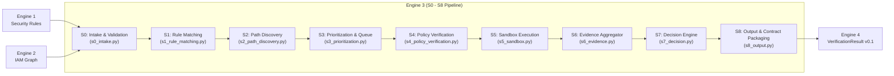

# Project IAM — Engine 3: Attack Path Discovery & Verification

Engine 3 consumes IAM graph snapshots (`IAMGraph v0.1` from Engine 2) and curated security rules (`SecurityRule[]` from Engine 1), discovers multi-hop privilege escalation paths, verifies them through policy simulation and sandboxed execution, and emits a standard `VerificationResult v0.1` deliverable for Engine 4.

---

## 🏗️ Architecture & Pipeline Overview



---

## 📦 Pipeline Stages (S0 – S8)

### Stage 0: Intake & Contract Validation ([`s0_intake.py`](file:///d:/Project%20IAM/engine3/src/engine3/s0_intake.py))
- Validates `IAMGraph v0.1` and `SecurityRule v0.1` inputs against strict contract schemas.
- Computes SHA256 integrity digests for graph and rulebook inputs.
- Verifies graph consistency: detects duplicate node IDs, invalid/dangling edge endpoints, unknown enum values, unsupported versions (`ERR_UNSUPPORTED_CONTRACT_VERSION`), and missing required rule fields.
- Handles partial collection states by marking the pipeline in degraded mode.

### Stage 1: Rule Matching ([`s1_rule_matching.py`](file:///d:/Project%20IAM/engine3/src/engine3/s1_rule_matching.py))
- Matches active security rules against graph permission nodes using contract model fields (`action`, `principal_type`, `resource_type`, condition blocks).
- Applies deterministic rule status filtering (`active` vs `draft`/`inactive`).
- Retains rule metadata (`source_path_id`) without altering matching semantics.

### Stage 2: Attack Path Discovery ([`s2_path_discovery.py`](file:///d:/Project%20IAM/engine3/src/engine3/s2_path_discovery.py))
- Traverses the graph from starting principals to target high-privilege resources using depth-bounded search (`max_depth=6`).
- Deterministic cycle detection prevents infinite loops without path explosion.
- Generates reproducible, deterministic `path_id` digests for every candidate path.

### Stage 3: Prioritization & Queue ([`s3_prioritization.py`](file:///d:/Project%20IAM/engine3/src/engine3/s3_prioritization.py))
- Scores and ranks candidate attack paths using a worked formula combining rule severity (`CRITICAL`, `HIGH`, `MEDIUM`, `LOW`), hop count, and assumption penalties.
- Deterministic tie-breaking ensures identical queue rankings across runs.

### Stage 4: Policy Verification ([`s4_policy_verification.py`](file:///d:/Project%20IAM/engine3/src/engine3/s4_policy_verification.py))
- **Local Evaluator**: Offline deterministic simulation evaluating explicit Deny policies, permission boundaries, and conditions.
- **Live AWS Policy Simulator**: Supported with strict gate controls (`APPROVE-LIVE-SIM`), per-hop evaluation (`SimulatePrincipalPolicy`), and rate-limit backoff handling.

### Stage 5: Sandbox Execution ([`s5_sandbox.py`](file:///d:/Project%20IAM/engine3/src/engine3/s5_sandbox.py) & Subsystems)
- **Terraform Generator ([`terraform_generator.py`](file:///d:/Project%20IAM/engine3/src/engine3/sandbox/terraform_generator.py))**: Generates branch-specific IAM Terraform configurations with dry-run planning and guaranteed `terraform destroy` teardown.
- **Dynamic Module Resolver ([`module_resolver.py`](file:///d:/Project%20IAM/engine3/src/engine3/sandbox/module_resolver.py))**: Indexes all 179 rules in `active_rulebook.json` to on-disk `pathfinding.cloud` YAML module definitions (175 privesc modules + 4 synthetic target exfiltration goals).
- **Client Hierarchy ([`pathrunner_client.py`](file:///d:/Project%20IAM/engine3/src/engine3/sandbox/pathrunner_client.py))**:
  - `PathrunnerClient` (Abstract Base Class).
  - `SubprocessPathrunnerClient`: Real CLI execution with clean environment scrubbing, timeout enforcement, and 4 mandatory safety gates.
  - `MockPathrunnerClient`: Explicitly tagged `[MOCK]` client for offline unit testing; never emits untagged verification findings.
- **Branch Orchestrator ([`orchestrator.py`](file:///d:/Project%20IAM/engine3/src/engine3/sandbox/orchestrator.py))**: Walks branch hops in sequence, enforcing post-hop identity transitions. Consumes credentials *only* from captured module outputs (zero string sniffing, zero credential fabrication).
- **Stopwatch Timers**: Records real millisecond timings for `deploy`, `execute`, and `destroy` phases in `runtime_metrics.sandbox_breakdown_ms`.

### Stage 6: Evidence Aggregator ([`s6_evidence.py`](file:///d:/Project%20IAM/engine3/src/engine3/s6_evidence.py))
- Collects and packages graph hops, policy simulator details, sandbox logs, and technical limitations.
- Strictly decoupled from exploitability decision-making (evidence collection only).

### Stage 7: Decision Engine ([`s7_decision.py`](file:///d:/Project%20IAM/engine3/src/engine3/s7_decision.py))
- Evaluates aggregated evidence against the formal 5-tier Verification Status Ladder:
  1. `VERIFIED_EXPLOITABLE`
  2. `POLICY_VERIFIED_NO_SANDBOX`
  3. `PARTIAL_CHAIN_VERIFIED`
  4. `SANDBOX_FAILED`
  5. `POLICY_DENIED`

### Stage 8: Output Package & Contract Deliverable ([`s8_output.py`](file:///d:/Project%20IAM/engine3/src/engine3/s8_output.py))
- Emits the final deliverable `runs/final_verification_results.json` strictly conforming to `VerificationResult v0.1` JSON schema and `engine4_handoff_example.json`.
- Enforces contract compliance: `path_id`, contract enum statuses, structured evidence, and runtime stopwatch metrics.

---

## 🔒 Mandatory Safety Gates

Subprocess and live execution paths require explicit confirmation tokens to prevent accidental live AWS modifications:

| Gate | Purpose | Required Parameter / Token |
| :--- | :--- | :--- |
| **Budget Confirmation** | Protects against unexpected cloud spend | `budget_confirmed=True` |
| **Account Allowlist** | Restricts deployment to authorized sandbox accounts | `account_id_confirmed in ALLOWED_ACCOUNTS` |
| **Sandbox Deploy Gate** | Authorizes Terraform deployment | `gate_token="APPROVE-DEPLOY"` |
| **Live Simulator Gate** | Authorizes live AWS Policy Simulator API calls | `gate_token="APPROVE-LIVE-SIM"` |

---

## 🧪 Testing & CI Drift Prevention

The test suite contains **78 tests (100% passing)**:
- **Contract Drift Prevention ([`test_s8_contract_drift.py`](file:///d:/Project%20IAM/engine3/tests/test_s8_contract_drift.py))**: Recursively asserts that S8 output structure matches `engine4_handoff_example.json`.
- **Pathrunner Client & Orchestrator ([`test_pathrunner_client.py`](file:///d:/Project%20IAM/engine3/tests/test_pathrunner_client.py))**: Asserts safety gate refusals, safe `argv` construction without `shell=True`, mock tagging, and intermediate credential requirement enforcement.
- **Dynamic Module Resolver ([`test_module_resolver.py`](file:///d:/Project%20IAM/engine3/tests/test_module_resolver.py))**: Verifies all 179 rules resolve against on-disk YAML modules.
- **Stage Mutations & Schema Suites ([`test_s0_load.py`](file:///d:/Project%20IAM/engine3/tests/test_s0_load.py) - [`test_verification_statuses.py`](file:///d:/Project%20IAM/engine3/tests/test_verification_statuses.py))**: Mutation fuzzing, cycle handling, ladder status validation, and E2E runs across sample tree fixtures.

```powershell
# Run the complete test suite
pytest -v
```

---

## 🚀 Quick Execution

To run the full pipeline on fixture data:
```powershell
python -m engine3.stages.runner
```
Output deliverable is saved to: `runs/final_verification_results.json`.
