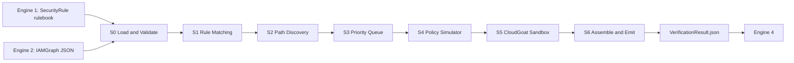

# AWS IAM Project — Engine 3 (Attack-Path Discovery & Verification)

Complete project documentation: setup, external repositories, tools, agent rules, and the stage-by-stage workflow.

Status as of 2026-10-07: commit `59e81be`, 57 commits, **58/58 tests passing**.

---

# PART A — QUICK START

## A1. Prerequisites

| Requirement | Version | Needed for | Check command |
|---|---|---|---|
| Windows 10/11, macOS or Linux | — | Everything | — |
| **Python** | **3.11+** (developed on 3.11.9) | Everything | `python --version` |
| **Git** | any recent | Clone repo and data sources | `git --version` |
| pip / venv | bundled with Python | Install dependencies | `pip --version` |
| PyYAML | any | **Only** to regenerate the rulebook from pathfinding.cloud | `pip show pyyaml` |
| AWS CLI v2 + credentials | — | **Optional.** Only for Live Policy Simulator (gated) | `aws --version` |
| Terraform | ≥ 1.5 | **Optional.** Only for real CloudGoat deploys (gated, not used yet) | `terraform -version` |

> No AWS account, credentials or money is needed to run the pipeline, tests or benchmark. Everything runs offline against JSON fixtures.

## A2. Get the project from GitHub

```powershell
git clone https://github.com/phoenix-2211/AWS-IAM-Project.git
cd AWS-IAM-Project\engine3
```

> If the repo isn't on GitHub yet, push it first from the local machine:
> `cd "D:\Project IAM"` → `git push -u origin master` (create the empty repo `AWS-IAM-Project` at https://github.com/new first).

## A3. Create the environment and install

**Windows (PowerShell)**
```powershell
python -m venv .venv
.\.venv\Scripts\Activate.ps1
pip install --upgrade pip
pip install -e ".[dev]"          # pydantic, jsonschema, boto3, pytest, ruff
pip install pyyaml               # optional: only for rulebook regeneration
```

**macOS / Linux (bash)**
```bash
python3 -m venv .venv
source .venv/bin/activate
pip install --upgrade pip
pip install -e ".[dev]"
pip install pyyaml
```

## A4. Verify the install

```powershell
pytest tests/                    # expected: 58 passed
ruff check src tests             # lint
```

> Run `pytest` from inside `engine3/`. Running it from the repo root fails with `FileNotFoundError`, because the tests use paths relative to `engine3/`.

## A5. Run the pipeline

```powershell
# Run all fixture graphs (tree_1 … tree_6) through S0→S6.
# Writes runs/<tree>/VerificationResult.json and output/VerificationResult.json
python scratch/run_all_sample_trees.py

# Run the industry-scale benchmark (tree_7, derived from BishopFox/iam-vulnerable)
python scratch/evaluate_iam_vulnerable_benchmark.py
```

From Python:
```python
from pathlib import Path
from engine3.stages.runner import PipelineRunner

PipelineRunner().run(
    graph_path=Path("docs/contracts/fixtures/tree_5_critical.json"),
    rulebook_path=Path("rulebook/active_rulebook.json"),
    out_dir=Path("output"),
)
```

> `engine3` (the console command from `pyproject.toml`) is currently a stub. It only prints the version. Use the scripts or `PipelineRunner` above.

## A6. Optional — fetch the external data sources (pinned)

These were used to **build** the rulebook and the tree_7 fixture. The outputs are already committed, so you only need these to rebuild them.

```powershell
# 1) DataDog pathfinding.cloud → source of the 179-rule rulebook
git clone https://github.com/DataDog/pathfinding.cloud.git scratch/pathfinding.cloud
git -C scratch/pathfinding.cloud checkout a4348edca61993638c6bfb0e699eac2411a09b87
python scratch/convert_pathfinding_to_rulebook.py        # OVERWRITES rulebook/active_rulebook.json (see caution below)

# 2) Bishop Fox IAM Vulnerable → source of tree_7_industry_scale.json (static parse, NO terraform apply)
git clone https://github.com/BishopFox/iam-vulnerable.git scratch/iam-vulnerable
git -C scratch/iam-vulnerable checkout 0f298666f9b7cfa01488b86912afdb211773188a
python scratch/convert_iam_vulnerable_to_fixture.py      # rewrites docs/contracts/fixtures/tree_7_industry_scale.json

# 3) CloudGoat → only for future live sandbox verification (gated, not deployed so far)
git clone https://github.com/RhinoSecurityLabs/cloudgoat.git ..\cloudgoat
```

> [!CAUTION]
> `convert_pathfinding_to_rulebook.py` overwrites the committed rulebook. The committed file (179 rules) also contains hand-fixed CloudGoat mappings and trap-compatible rules added during the closeout work. Diff the regenerated file against git before committing it.

## A7. External repositories used

| Repo | URL | Pinned commit | Used for | How |
|---|---|---|---|---|
| **DataDog pathfinding.cloud** | https://github.com/DataDog/pathfinding.cloud | `a4348edc…` | Rulebook (92 real privesc paths, required permissions, detection-tool cross-refs, attribution) | Parsed `data/paths/aws/**/*.yaml` |
| **Rhino Security Labs — AWS IAM Privilege Escalation** | https://github.com/RhinoSecurityLabs/AWS-IAM-Privilege-Escalation | — | Original 21+ privesc methods; the foundation pathfinding.cloud builds on | Reference / provenance |
| **Rhino Security Labs — CloudGoat** | https://github.com/RhinoSecurityLabs/cloudgoat | — | Real scenario names mapped to rules (sandbox stage) | Scenario list only. No deployment yet |
| **Bishop Fox — IAM Vulnerable** | https://github.com/BishopFox/iam-vulnerable | `0f298666…` | Industry-scale benchmark graph (31 privesc paths, 175 nodes) | Static `.tf` parsing of `modules/free-resources/` |
| PMapper, Cloudsplaining, Prowler, Pacu | (via pathfinding.cloud cross-refs) | — | Detection-tool provenance links in each rule | Metadata only, not executed |
| MITRE ATT&CK for Cloud | https://attack.mitre.org/matrices/enterprise/cloud/ | — | `technique_id` on each rule (T1098, T1098.001/.003, T1078.004, T1530…) | Metadata |
| AWS IAM docs / boto3 | docs.aws.amazon.com, boto3 docs | — | `simulate_principal_policy` semantics for S4 | Reference + `LivePolicySimulator` |

---

# PART B — WHAT WAS BUILT

## B1. Architecture overview

Engine 3 sits between Engine 2 (graph construction) and Engine 4 (scoring, explanations and UI).



**Scope** (from `.agents/rules/engine3-rules.md`):
- **Engine 3 owns:** rule matching, attack-path discovery, the verification queue, Policy Simulator checks, CloudGoat verification, and emitting `VerificationResult`.
- **Engine 3 does NOT own:** AWS collection or graph building (Engine 2), rule generation (Engine 1), risk scoring, explanations, dashboards or review UI (Engine 4).

## B2. Tools & technologies used

| Category | Tool | Role |
|---|---|---|
| Language | Python 3.11 | Whole engine |
| Data contracts | **Pydantic v2** | Typed models (`src/engine3/contracts/models.py`) |
| Schema validation | **jsonschema** | Validates IAMGraph, SecurityRule, VerificationResult (`schemas/*.schema.json`) |
| AWS SDK | **boto3** | `LivePolicySimulator` → `iam.simulate_principal_policy` (gated, unused in offline mode) |
| Testing | **pytest** | 58 tests: unit, mutation, adversarial, e2e |
| Lint/format | **ruff** | line-length 100, py311 |
| Data parsing | **PyYAML**, `re`, `glob` | pathfinding.cloud YAML and IAM Vulnerable `.tf` parsing |
| Version control | **Git** | Per-stage commits, oracle-first commits, tags |
| AI pair programmer | **Antigravity agent** with workspace **rules** + **skills** | Built the code under the always-on rules below |
| Sandbox (planned) | CloudGoat + Terraform + AWS CLI | Live exploit verification (currently MOCKED) |

## B3. Agent rules (always-on) — `.agents/rules/engine3-rules.md`

These rules governed **every** stage.

**Honesty**
1. Never edit an expected test value to make a test pass. A wrong oracle must go through an `audit/oracle_change_requests/<n>.md` request.
2. **Oracles before code.** Hand-derive expected outputs in `tests/oracles/sN_expected.md` and commit them before the implementation. You can see this in the git log as `oracle:` commits before each `sN.0:` commit.
3. Empty logs count as failure. Every stage writes evidence to `runs/<run_id>/`.
4. Report failures first.
5. No phase is marked complete without an audit report.
6. **Proven ≠ assumed.** A simulator "allowed" is not a confirmed exploit. This is the reason the status ladder exists.
7. Never invent contract vocabulary. Stop and ask instead.
8. Verify AWS, CloudGoat and Terraform behaviour against current official docs, and record the URL and date (`docs/research/SOURCES.md`).

**Safety**

9. No secrets in the repo. Credentials come only from the environment or a profile.
10. No AWS calls, live simulator calls, or deploy/destroy without a human gate token.
11. CloudGoat may only run in a confirmed, dedicated sandbox account.
12. Always tear down and verify teardown.

**Human gate tokens** (must be typed exactly): `APPROVE-VOCAB`, `APPROVE-LIVE-SIM`, `APPROVE-DEPLOY`, `APPROVE-DESTROY`.

**Graph semantics**

15. An edge is never proof of authorization, and a missing edge is never proof of absence.
16. IDs are opaque. Never split them on `|`.
17. `legacy/` code is never imported.

## B4. Agent skills (9) — `.agents/skills/*/SKILL.md`

| Skill | Loaded during | What it enforces |
|---|---|---|
| `contract-guard` | S0, S6, any contract I/O | Exact IAMGraph / SecurityRule / VerificationResult field shapes and enums |
| `aws-iam-semantics` | S1, S4 | Policy evaluation order, explicit deny wins, wildcards, NotAction/NotResource, permission boundaries, PassRole/AssumeRole |
| `rule-matching-semantics` | S1 | When a rule matches a statement |
| `path-discovery-bounds` | S2, S3 | Traversal bounds (max depth 6), cycle handling, deterministic path IDs and ordering |
| `policy-simulator-usage` | S4 | `SimulatePrincipalPolicy` parameters, decisions (`allowed`/`explicitDeny`/`implicitDeny`), limitations |
| `cloudgoat-sandbox-ops` | S5 | Install, deploy and destroy CloudGoat safely. Real scenario names only |
| `verification-status-ladder` | S3–S8 | Which status may be assigned given which evidence |
| `evidence-redaction` | S5, S6, any logs | Redact ARNs, keys and account data before writing evidence |
| `run-artifacts-and-resume` | Start/end of every stage | Run directories, manifests, resuming after an interruption |

## B5. Repository layout (tracked files)

```
AWS-IAM-Project/
├── .gitignore
├── .agents/
│   ├── rules/engine3-rules.md
│   └── skills/<9 skills>/SKILL.md
└── engine3/
    ├── pyproject.toml, README.md, PROGRESS.md
    ├── schemas/                      iamgraph_v0.1 / security_rule_v0.1 / verification_result_v0.1 .schema.json
    ├── rulebook/active_rulebook.json 179 ACTIVE rules
    ├── src/engine3/
    │   ├── contracts/models.py       Pydantic models
    │   ├── adapters/                 graph_adapter, rule_adapter, canonical_adapter (Engine 2/1 → internal)
    │   ├── stages/                   s0_load, s1_match, s2_path, s3_queue, s4_sim, runner
    │   ├── sandbox/s5_sandbox.py     CloudGoat runner (MOCKED)
    │   ├── emit/s6_emit.py           VerificationResult assembler
    │   └── cli.py                    stub
    ├── tests/                        11 test modules + oracles/s0..s6_expected.md
    ├── docs/
    │   ├── contracts/                IAMGraph_v0.1.md, MANIFEST.json, fixtures/tree_1..tree_7
    │   ├── research/                 SOURCES.md, scenario_map.md, cost_guardrails.md
    │   ├── audit/final_audit.md, decisions.md, open_questions.md, engine4_handoff_example.json
    └── scratch/                      build and benchmark scripts (convert_*, evaluate_*, run_all_sample_trees.py)
```

---

# PART C — WORKFLOW, STAGE BY STAGE

Each stage below lists its **purpose**, **files**, **agent rules/skills applied**, **security rules/data used**, **tests**, and **output**.

## Stage 0 — Load & Validate

- **Purpose:** Refuse bad input before any analysis runs.
- **Files:** `stages/s0_load.py`, `contracts/models.py`, `schemas/*.json`, `adapters/*`
- **Skills:** `contract-guard`, `run-artifacts-and-resume`
- **Agent rules:** #7 (no invented vocabulary), #16 (opaque IDs), gate `APPROVE-VOCAB`
- **Checks:** contract name and version, duplicate node IDs, dangling or invalid edges, unknown enums or node/edge types, duplicate `rule_id`, bad rule status, coverage consistency, `x_provenance` present, SHA-256 tamper detection of the input graph.
- **Tests:** `test_s0_load.py`, with 22 mutation tests (`mutation_01` … `mutation_20`, plus tamper and schema-negative cases).
- **Output:** a validated graph, the active rules, and input SHA-256 hashes (recorded in `inputs`).

## Stage 1 — Rule Matching

- **Purpose:** Find which rulebook rules apply to which principals and resources in the graph.
- **Files:** `stages/s1_match.py`
- **Skills:** `rule-matching-semantics`, `aws-iam-semantics`
- **Agent rules:** #15 (edge ≠ authorization), #6
- **Security rules used:** `rulebook/active_rulebook.json`, with **179 rules, all ACTIVE (125 CRITICAL, 54 HIGH)**.
  - Built from all **92 pathfinding.cloud paths** (DataDog, building on Rhino Security Labs).
  - Each rule carries: `required_actions`, `principal_type`, `resource_type`, `relationship`, `severity`, `condition`, MITRE `technique_id`, `source` (tier `CANONICAL_RESEARCH`), `evidence.detection_tools`, and in `extras` the `source_path_id`, `category`, detection-tool source links (PMapper / Cloudsplaining / Prowler / Pacu) and `cloudgoat_scenario`.
  - Example: `RULE-IAM-S3-001` — `s3:GetObject` on an `s3_bucket` → T1530, CloudGoat `cloud_breach_s3`.
  - Categories covered: `iam:PassRole` + service (EC2, Lambda, Glue, CodeBuild, CloudFormation, SageMaker, ECS, Batch…), policy-version abuse (`CreatePolicyVersion` / `SetDefaultPolicyVersion`), `Attach*/Put*Policy`, `CreateAccessKey` / `CreateLoginProfile` / `UpdateLoginProfile`, `UpdateAssumeRolePolicy`, group membership, and data access (S3, Secrets Manager).
- **Matching semantics:** Allow/Deny effects, action wildcards (`iam:*`, `*`), NotAction/NotResource, conditions, and deterministic ordering.
- **Tests:** `test_s1_match.py` (6 tests: baseline, negative no-match, all rules, empty graph, deterministic order, sample trees).
- **Rulebook history:** a 12-rule seed was replaced by the 179-rule pathfinding.cloud rulebook. A regression to 27 Rhino-only rules (commit `058bda5`) was found and reverted, restoring the rich version from `a7f5314`.

## Stage 2 — Attack-Path Discovery

- **Purpose:** Chain matched rules and trust edges into multi-hop escalation paths, from an entry principal to a sensitive target.
- **Files:** `stages/s2_path.py`
- **Skills:** `path-discovery-bounds`
- **Bounds:** `max_depth=6`, cycle prevention, self-loop filtering, and **canonical deduplication by hop sequence `(from_node, to_node, action_used)`**. A path is not counted again just because a different rule found it.
- **Path ID:** a deterministic hash of the hop sequence, so the same path gets the same ID on every run.
- **Tests:** `test_s2_path.py` (5 tests, including the hand-enumerated 18-path matrix).
- **Dedup audit (tree_7):** all 46 paths for `fn1-privesc3-partial-user` are distinct (46 different `iam:PassRole` service rules). **0 duplicates.**

## Stage 3 — Prioritized Queue

- **Purpose:** Decide what to verify first.
- **Files:** `stages/s3_queue.py`
- **Skills:** `path-discovery-bounds`, `verification-status-ladder`
- **Ordering:** rule severity (CRITICAL > HIGH > …), then fewer hops, then fewer assumptions, then a deterministic tie-break.
- **Output fields:** `queue_rank`, `queue_reason` (e.g. `"severity CRITICAL, 3 hops, 0 assumptions"`), and `assumptions` such as `deny_present` or `trust_structural_only`.
- **Tests:** `test_s3_queue.py` (3 tests).

## Stage 4 — Policy Simulation

- **Purpose:** Check every hop against IAM policy logic.
- **Files:** `stages/s4_sim.py`, containing `LocalPolicySimulator` (default, offline) and `LivePolicySimulator` (boto3 `simulate_principal_policy`, behind gate `APPROVE-LIVE-SIM`).
- **Skills:** `policy-simulator-usage`, `aws-iam-semantics`
- **Agent rules:** #6, #10
- **Evidence per hop:** `hop_index`, `from_node`, `to_node`, `action_used`, `decision`, `eval_decision` (`allowed` / `explicitDeny` / `implicitDeny`), `missing_context`, and a plain-English `note`.
- **When a path is denied:** `denying_hop_details` records which hop was denied, from/to, the action, and the reason type (explicit or implicit).
- **Limitations recorded on every path:** SCP/RCP/session policies not evaluated, permission boundaries checked only by ARN, and "local_evaluator, not AWS".
- **Tests:** `test_s4_sim.py` (5 tests).

## Stage 5 — CloudGoat Sandbox Verification

- **Purpose:** Try to actually run the exploit in a throwaway lab.
- **Files:** `sandbox/s5_sandbox.py`, containing `MockCloudGoatSandboxRunner`.
- **Skills:** `cloudgoat-sandbox-ops`, `evidence-redaction`
- **Agent rules:** #9–#12, gates `APPROVE-DEPLOY` / `APPROVE-DESTROY`
- **Real CloudGoat scenarios only** (invented names were removed): `vulnerable_lambda`, `vulnerable_cognito`, `iam_privesc_by_key_rotation`, `iam_privesc_by_rollback`, `lambda_privesc`, `cloud_breach_s3`, `iam_privesc_by_attachment`, `ec2_ssrf`, `ecs_takeover`, `rce_web_app`, `codebuild_secrets`, `cicd`.
- **Behaviour:** skipped if S4 denied the path, or if no scenario maps to the rule (status becomes `POLICY_VERIFIED_NO_SANDBOX`). Otherwise the scenario is mock-executed and the following are recorded: `sandbox_attempted`, `sandbox_execution_success`, `sandbox_failure_reason` (timeout / credential error / malformed scenario / …), redacted logs, and an evidence ref.
- **Current mode:** **MOCKED.** No AWS deploys have happened.
- **Tests:** `test_s5_sandbox.py` (4 tests).

## Stage 6 — Assemble & Emit

- **Purpose:** Produce the single handoff file for Engine 4.
- **Files:** `emit/s6_emit.py`, `stages/runner.py` (S0→S6 orchestrator)
- **Skills:** `contract-guard`, `verification-status-ladder`, `evidence-redaction`, `run-artifacts-and-resume`
- **Status ladder (strongest → weakest):**

| Status | Confidence tier | Meaning |
|---|---|---|
| `VERIFIED_EXPLOITABLE` | `FULL_CHAIN_VERIFIED` | Every hop allowed **and** the sandbox exploit succeeded |
| `PARTIAL_CHAIN_VERIFIED` | `PARTIAL_CHAIN_VERIFIED` | Verified up to a technical limitation |
| `POLICY_VERIFIED_NO_SANDBOX` | same | Policy allows it, but no CloudGoat scenario exists for the rule |
| `POLICY_ALLOWED` | — | Policy allows it, sandbox still pending |
| `SANDBOX_FAILED` | `SANDBOX_EXECUTION_FAILED` | Policy allowed it, but the sandbox run failed (reason recorded) |
| `POLICY_DENIED` | `POLICY_DENIED` | Blocked at a specific hop (explicit or implicit deny) |

- **Output:** `output/VerificationResult.json`, `output/queue.json`, `output/run_manifest.json`, and per-tree `runs/<tree>/VerificationResult.json`.
- **Validated against:** `schemas/verification_result_v0.1.schema.json`. The status enum is enforced, and a test rejects any non-enum status.
- **Tests:** `test_e2e_pipeline.py` (5), `test_verification_statuses.py` (2), `test_adversarial.py` (3).

### Output file shape (`VerificationResult.json`)
```jsonc
{
  "contract_name": "VerificationResult", "contract_version": "0.1",
  "run":    { "run_id", "mode", "simulator_backend", "sandbox_mode" },
  "inputs": { "iamgraph_snapshot_id", "iamgraph_content_sha256", "rulebook_sha256", "rules_active" },
  "degraded": false, "degraded_reasons": [],
  "paths": [ { "path_id", "status", "confidence_tier", "status_reason", "verification_scope",
               "hops": [...], "assumptions": [...], "queue_rank", "queue_reason",
               "evidence": { "policy_simulator_details": [...], "denying_hop_details": {...},
                             "sandbox_*": ... },
               "limitations": [...] } ],
  "runtime_metrics": {...}, "stats": { "paths_total", "by_status", "by_confidence_tier" }, "warnings": []
}
```

## Stages 7 & 8 — Enrichment & Final Audit

- **S7:** optional enrichment, **off** by default (`docs/stage7_not_enabled.md`).
- **S8:** final audit (`docs/audit/final_audit.md`), README, and the Engine 4 handoff example (`docs/engine4_handoff_example.json`).

---

# PART D — TEST FIXTURES & BENCHMARK

| Fixture | Purpose |
|---|---|
| `tree_1_benign` | No escalation. Must produce zero findings |
| `tree_2_low` … `tree_4_high` | Increasing severity |
| `tree_5_critical` | Multi-hop critical paths, plus the **explicit-deny trap** on `secret:prod/deny-trap-secret` that proves the three outcomes (VERIFIED / DENIED / SANDBOX_FAILED) all happen end to end. Latest run: 16 paths — 3 VERIFIED_EXPLOITABLE, 8 POLICY_DENIED, 3 SANDBOX_FAILED, 2 POLICY_VERIFIED_NO_SANDBOX |
| `tree_6_canonical` | Canonical Engine 2 reference input format |
| **`tree_7_industry_scale`** | Derived from **BishopFox/iam-vulnerable** (static parse). **175 nodes = 42 users + 46 roles + 76 permissions + 11 resources**, 197 edges |

**Industry benchmark result (tree_7):**
- **28 / 31** IAM Vulnerable privesc paths detected (**90.3%**). Detection is decided in S1+S2 and does not depend on the S4–S6 status logic.
- 634 attack paths (1,322 candidate variations), with 0 duplicates confirmed.
- End-to-end runtime **171.30 ms**.
- 3 paths missed (analysis in `scratch/analyze_missed_paths.py`).

---

# PART E — PROJECT TIMELINE (from git history)

1. **Skeleton & contracts.** Workspace, `.agents` rules and skills, contract digest, Pydantic models, adapters, vocabulary proposal.
2. **Stage 0.** JSON schemas, loader, oracle, 20 mutation tests, then hardening (coverage, duplicate rule_id, tamper SHA).
3. **Research.** `SOURCES.md`, `scenario_map.md`, `cost_guardrails.md`.
4. **Stages 1–6.** Each built the same way: an `oracle:` commit first, then the implementation and tests.
5. **Stage 8 audit.** Status-enum enforcement, rename to `LocalPolicySimulator`, `LivePolicySimulator` (boto3).
6. **Rulebook upgrades.** 12 rules → Rhino-derived → **179 rules from pathfinding.cloud** with detection-tool cross-refs and real CloudGoat names. Regression fix: `058bda5` → restored `a7f5314` content.
7. **Verification hardening** (`7421fd4`). Per-hop evidence, denying-hop details, specific sandbox failure reasons, confidence tiers, adversarial tests.
8. **Closeout** (`961a49b`). Restored the SANDBOX_FAILED trap behaviour on tree_5.
9. **Industry benchmark** (`59e81be`). tree_7 from IAM Vulnerable, with node-count and dedup audits.

---

# PART F — KNOWN GAPS (honest status)

| # | Gap | Impact |
|---|---|---|
| 1 | **Sandbox is MOCKED.** No real CloudGoat deploys | `VERIFIED_EXPLOITABLE` means "verified in the mock," not in real AWS |
| 2 | **S4 uses the local evaluator**, not AWS | SCPs, RCPs, session policies and resource policies are not evaluated |
| 3 | `action_used` on rule-matched hops is a placeholder (`rule_target:RULE-…`) instead of the real IAM action | Engine 4 can't show the real action for those hops |
| 4 | `POLICY_VERIFIED_NO_SANDBOX` paths can show `sandbox_attempted: true` with scenario `None` | Contradictory evidence flags |
| 5 | `run.started_at/finished_at/git_sha` and the `*_ms` timings are `null` in the emitted file | Missing run metadata |
| 6 | `engine3` CLI is a stub | Use the scripts or `PipelineRunner` |
| 7 | PyYAML is not listed in `pyproject.toml` | Install it manually before regenerating the rulebook |
| 8 | `PROGRESS.md` lists tags `engine3-s4…s8-complete`, but git only has tags up to `s3` plus the `s0-s8-sample-complete` tags | Documentation drift |
| 9 | `docs/research/SOURCES.md` still lists `iam_privesc_by_ec2`, which is not in the confirmed CloudGoat list | Stale doc |
| 10 | 3 of 31 IAM Vulnerable paths are not detected | Rule coverage gap |
